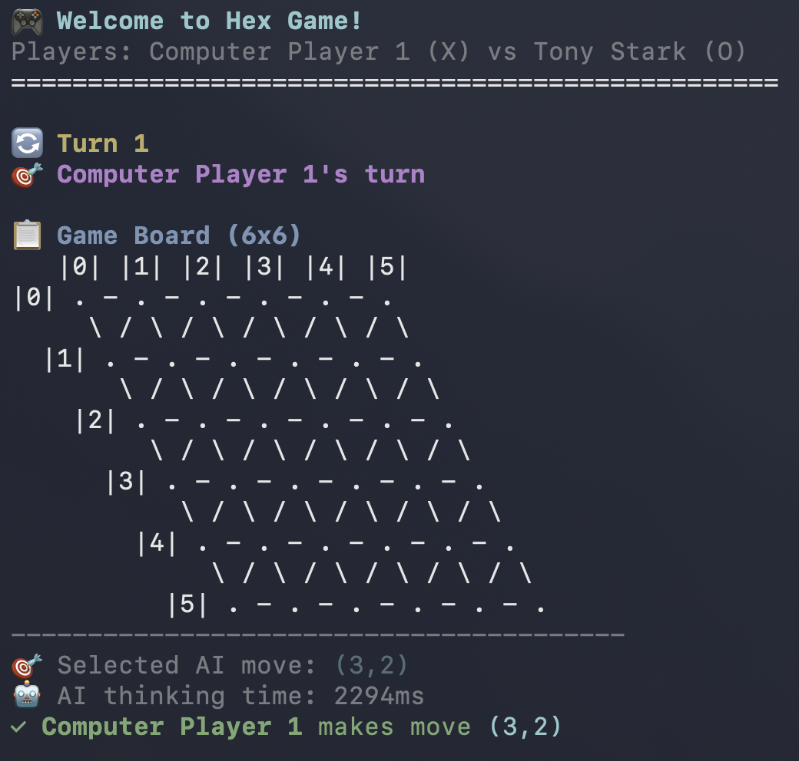
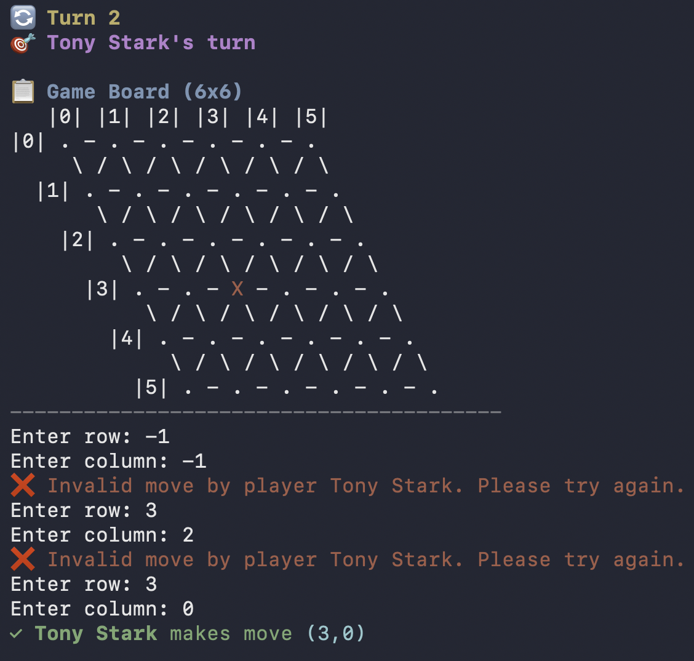
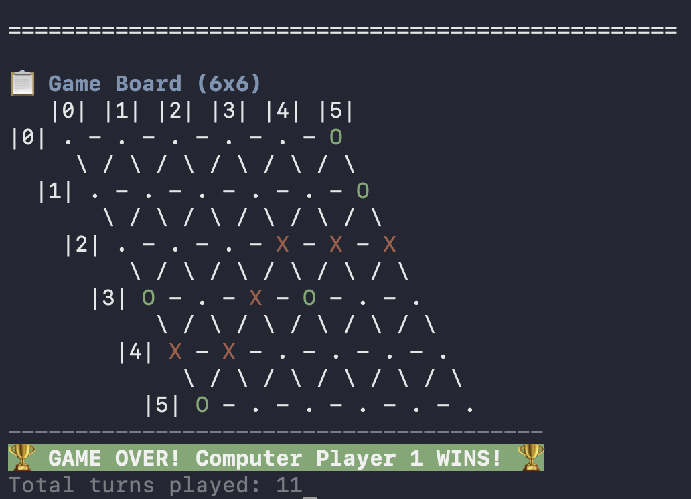

# hex-player

Implementation of a single player [Hex game](https://en.wikipedia.org/wiki/Hex_(board_game)) in C++ as part of Coursera's [C++ for C Programmers, Part B](https://www.coursera.org/learn/c-plus-plus-b/home/welcome) final project.

| Screenshot | Description |
| --- | --- |
|  | The game board is displayed with an empty 5x5 grid. Players are ready to begin placing their pieces. |
|  | The game shows an error message when a player attempts to place a piece in an invalid location (already occupied or out of bounds). |
|  | A victory message is displayed with celebration styling when the winner forms a successful bridge across the board. |

## Steps to run

Do the following to build the executable using the included CMakeLists.txt file.

In the terminal, navigate to the root folder (current working directory) and build the project using:

```console
cd hex-player  
mkdir build
cd build
cmake ..
make
```

Now run the executable:

```console
./hexplayer <board_size>
```

**Example:**

```console
./hexplayer 5
```
